# Linexus

Run the Corsair iCUE Nexus touch strip on Linux, and design its pages in a visual editor.

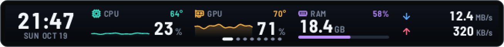

The Nexus is a 640 × 48 pixel touch display that Corsair supports only through iCUE on Windows. Linexus drives it directly over USB HID: a small daemon renders the pages, reads touches and runs actions, and **Linexus Studio**, a local web app, lets you build those pages with the same renderer the strip uses.

> Unofficial project. Not affiliated with, endorsed by or sponsored by Corsair. Corsair, iCUE and Nexus are trademarks of their respective owners and are used only to name the supported hardware.

One command installs it on Arch, Debian, Ubuntu, Fedora, openSUSE and their derivatives; see [Install](#install).

## Features

Every strip image on this page comes from Linexus's own renderer, at twice the size of the strip.

### System monitor

CPU, GPU, memory, disks and network as a number, a bar, a graph of the last minute or a ring. A reading can carry a second one in its corner and turn amber or red from limits you set.

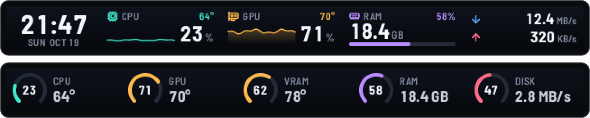

Most readings come straight from `/proc` and `/sys`: AMD graphics through amdgpu and every hwmon sensor (temperatures, fans, power, voltages). NVIDIA graphics are read through `nvidia-smi`, and the battery of wireless mice, keyboards, headsets and controllers through UPower. On the development machine (AMD graphics), the daemon and the helper programs it calls use under 1 % of one CPU core on a page of system readings; scrolling headlines and animations take more.

### Media controls

Album art, title and progress of whatever is playing in a player that supports MPRIS, such as Spotify, VLC or your browser. Skip and pause with the buttons, and drag along the slider to set the volume. When the track changes or the volume moves, a short pop-up shows it over any other page.

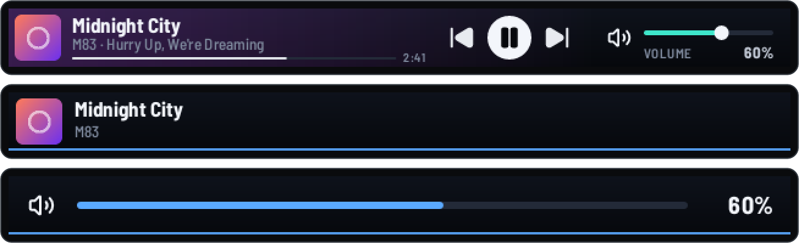

### App launcher and shortcuts

Buttons start apps from their desktop entries and can show the app's own icon and a dot while it runs. A button can also open a website or folder, press a keyboard shortcut, type text (also on Wayland, through a small input helper), mute the microphone, lock the screen, switch pages or profiles, call a Home Assistant service, send a web request, run a program (once you allow programs), or do several of these in a row.

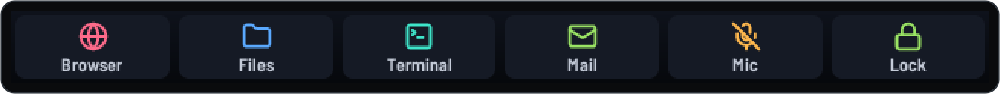

### News reader

Headlines from your RSS and Atom feeds in two rows, unread ones first, with long headlines scrolling across. Tap a headline to open the article, double tap to page through, hold one to hide it. To add a feed, type the website's address in Studio and it finds the feed.

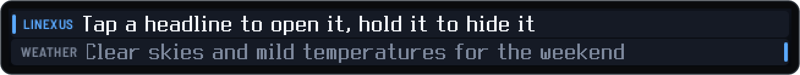

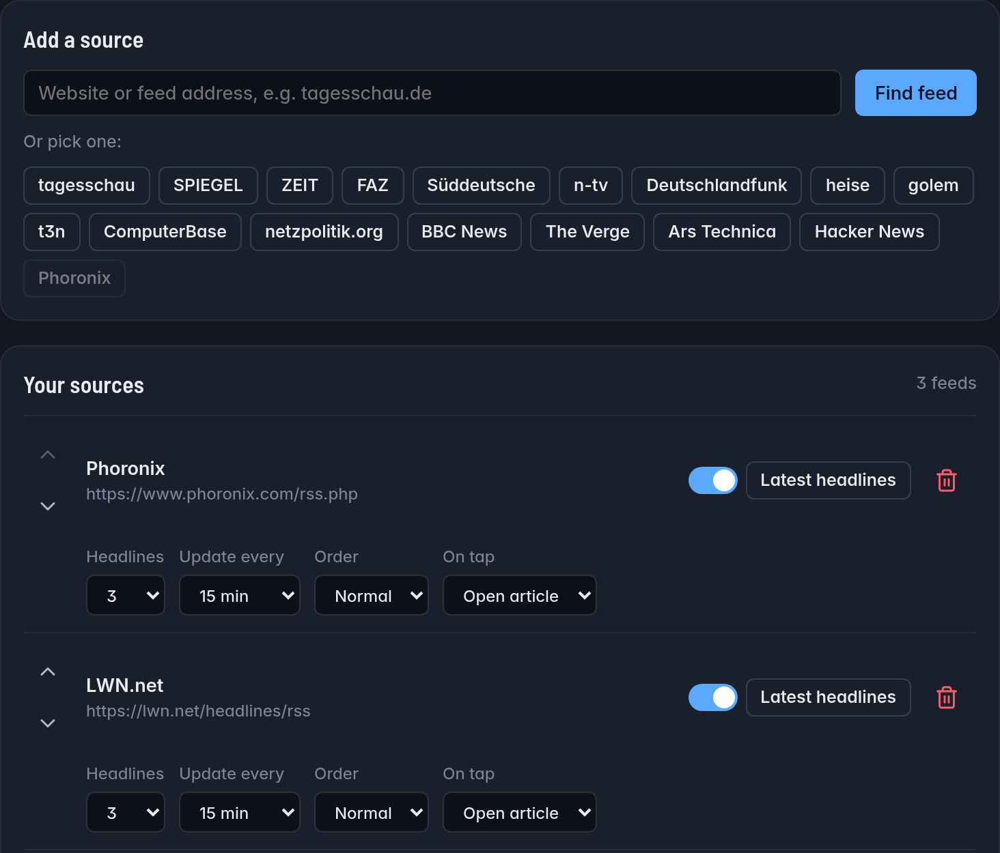

Scripts and other programs can put their own cards between the headlines through a local webhook, for example when a build finishes. Studio receives the cards, so it has to be running; add the name `build` under Connections, then:

```sh
curl -X POST http://127.0.0.1:19777/api/sensors/webhook/build \
  -H 'Content-Type: application/json' -d '{"message":"Build passed"}'
```

### Pomodoro, timer and stopwatch

A pomodoro timer counts focus phases, short and long breaks and rounds. Next to it, a countdown with your own name and a stopwatch. Tap to start or pause, double tap to skip to the next phase, hold to reset.

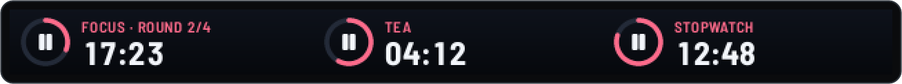

### Weather and clock

Current conditions and today's high and low from Open-Meteo, without an account or key, for a default place or a different one per widget. Clocks show the date and seconds if you like, in 24 or 12 hours.

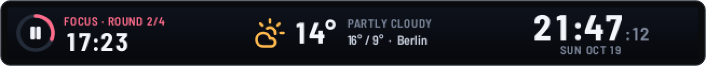

### Home Assistant

Tiles for your Home Assistant entities show their state and act on a tap: lights, switches, fans and covers toggle, scenes and scripts run, media players play or pause. Any button can call any other Home Assistant service.

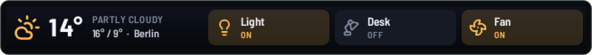

### OBS Studio

Record, pause, stream, switch scenes, mute audio sources, save replay clips and turn the virtual camera on, through OBS's own WebSocket server (OBS 28 or newer). The buttons show what OBS is doing: a recording or stream lights up red with its running time, the scene on air lights up in the accent colour, and a muted source lights up red with its microphone or speaker crossed out. The buttons fade while OBS is not running, and you can let a profile with OBS buttons take over while OBS is in front.

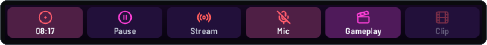

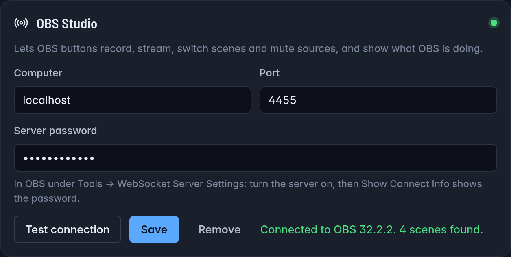

### Desktop notifications

Notifications slide over the current page for a few seconds, with the app's icon or the picture they carry. They come from any app, GNOME and Flatpak apps included, and follow your desktop: during Do Not Disturb only urgent ones appear, and apps whose pop-ups you turned off stay off the strip too. A touch dismisses them. Turn them on under Connections in Studio.

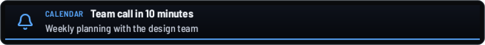

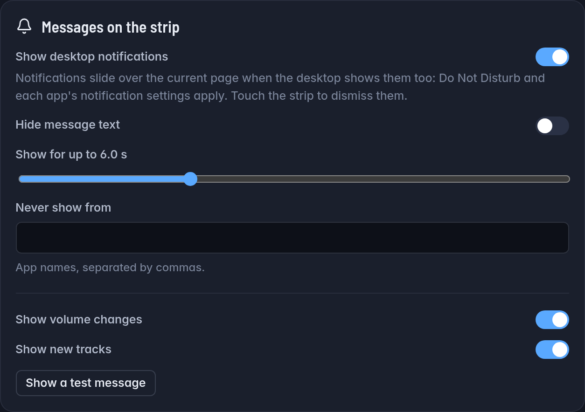

### Your own widgets

Text with live values such as `{cpu.temp}`, `{gpu.power}` or `{obs.scene}`, your own images, page backgrounds, and the first line a program prints, refreshed on an interval (once you allow programs).

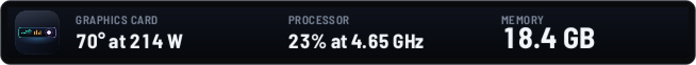

<table>
<tr>
<td width="50%" valign="top">

### Touch gestures

Each widget has its own action for a tap, a double tap and a hold, and a held button can repeat like a held key. Swipe to change pages: the page follows your finger and slides or fades into the next one. Pages you hide from swiping work like folders that a button opens.

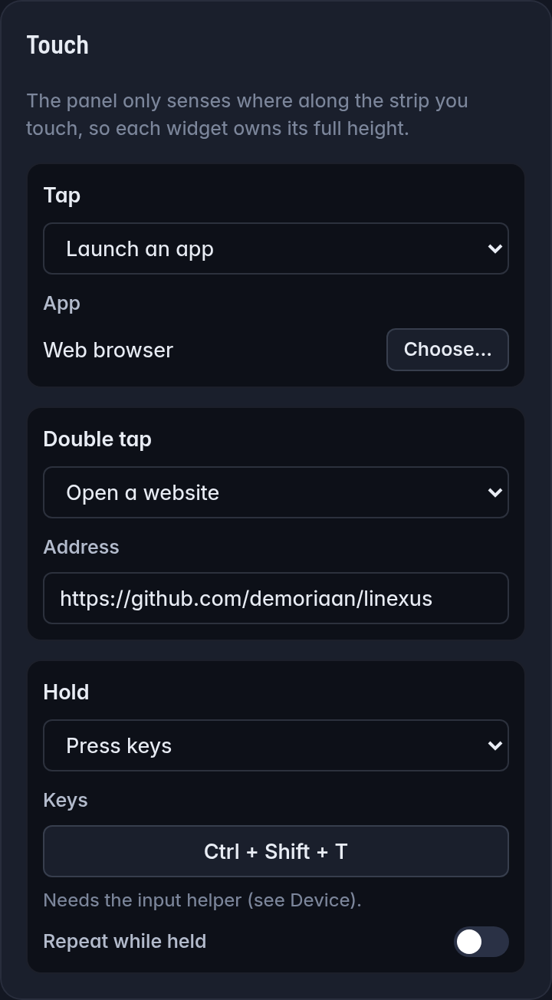

</td>
<td width="50%" valign="top">

### Profiles that follow your apps

A profile is a set of pages with its own theme and brightness. It can take over the strip while an app has focus, such as your OBS buttons while OBS is in front. Works on KDE Plasma, GNOME (through a small extension the installer sets up), Hyprland, Sway and X11.

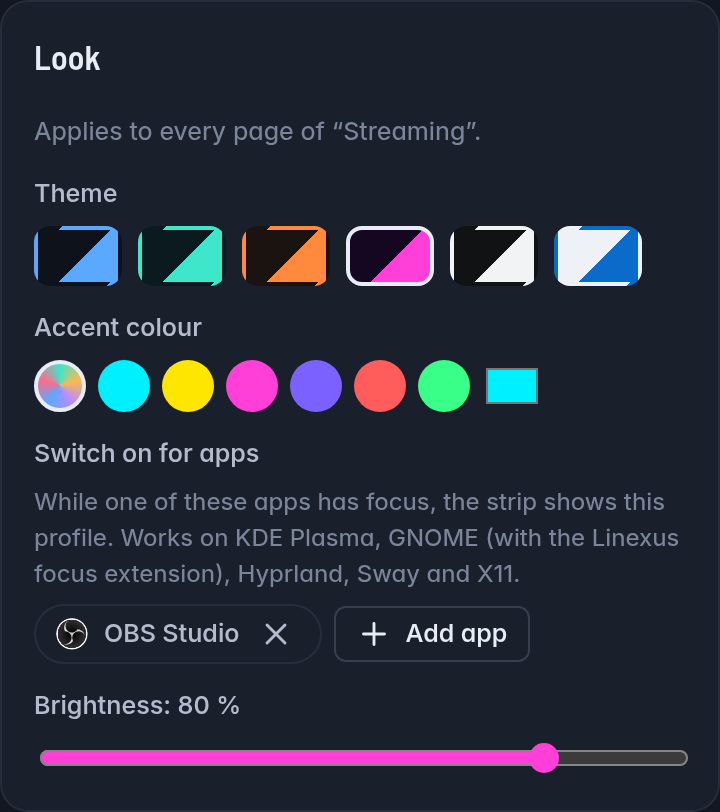

</td>
</tr>
</table>

### Dimming and sleep

The strip dims or turns off after a time without a touch, turns off while the screen is locked (on desktops whose screen locker tells logind, such as KDE Plasma and GNOME) or the computer sleeps, and wakes on the first touch without pressing the button under your finger.

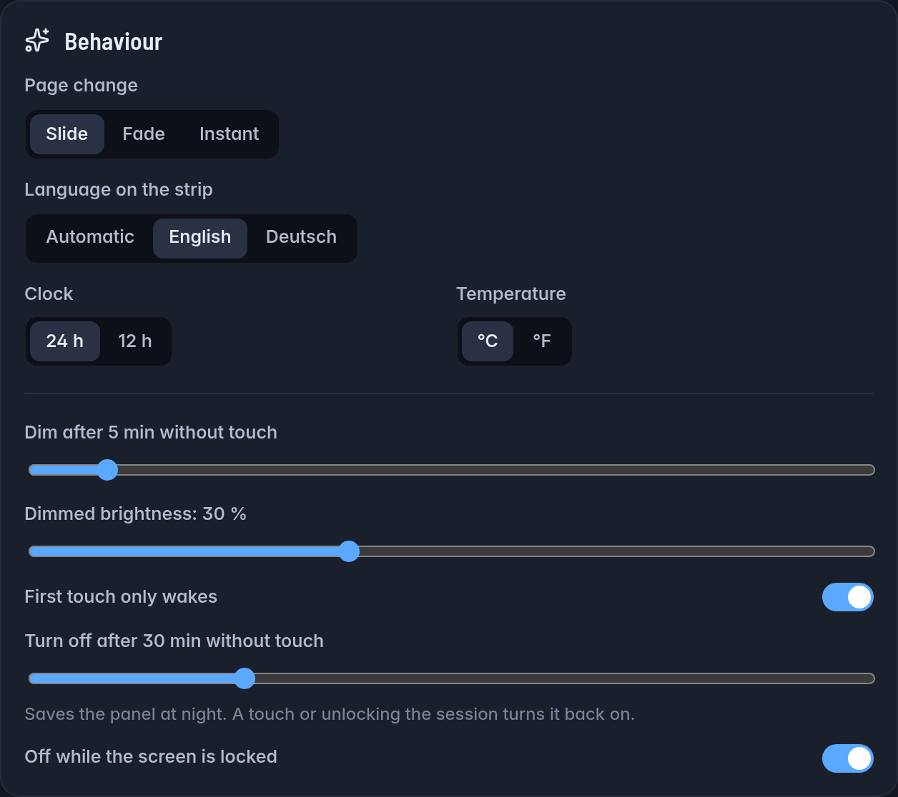

### Six themes

Midnight, Aurora, Ember, Neon, Mono and Daylight, each with an accent colour of your choice.

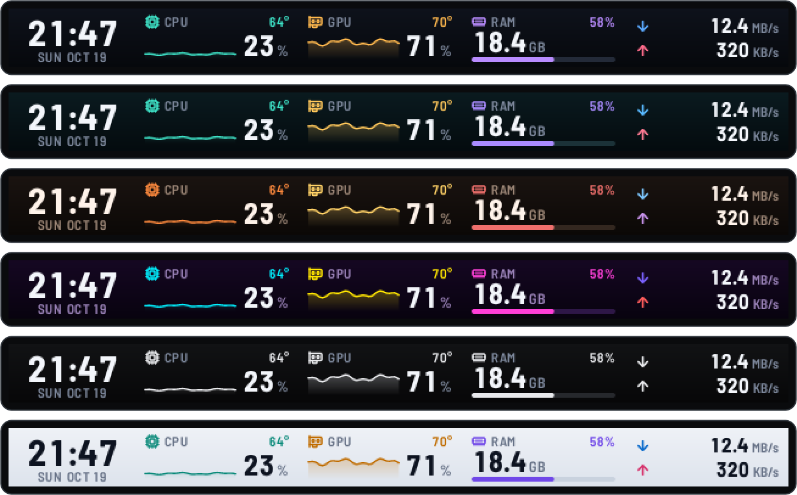

## Linexus Studio

Studio opens in your browser at `http://127.0.0.1:19777/` and edits the configuration the daemon reads. Every change shows on the strip at once.

<picture>
  <source media="(prefers-color-scheme: light)" srcset="docs/images/studio-light.webp">
  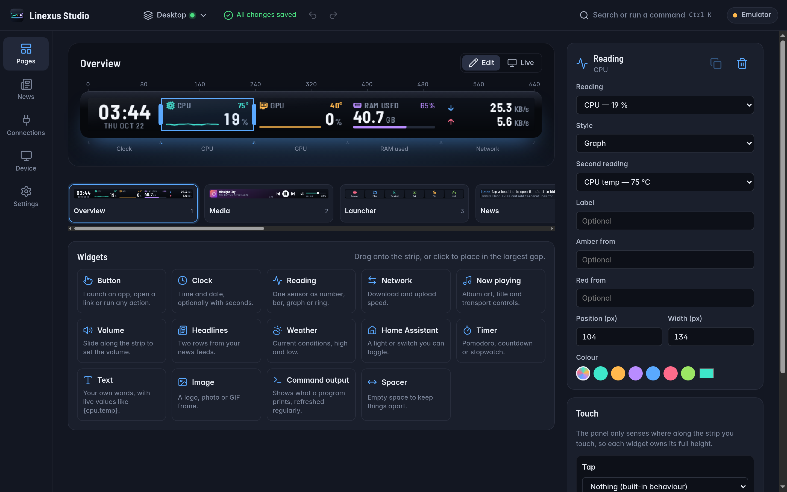
</picture>

- Drag widgets from the library onto the strip, move and resize them on an 8 px grid, and set what each gesture does.
- Changes save automatically. When the profile you edit is on the strip, the strip jumps to the page you are editing. Undo and redo keep your last 200 steps.
- A live mirror shows what the strip shows right now; clicking or dragging on it acts like a touch on the strip.
- Page templates, page backgrounds, English and German, light and dark mode.

<table>
<tr>
<td width="50%" valign="top">

### Command palette

<kbd>Ctrl</kbd>+<kbd>K</kbd> finds sections, profiles and the pages of the profile you edit, adds widgets and pages, shows a page on the strip, sets the brightness and restarts the daemon.

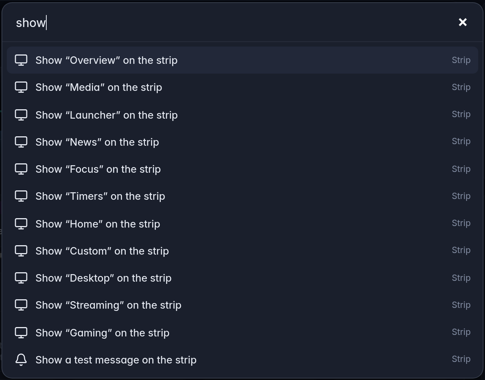

</td>
<td width="50%" valign="top">

### Setup checks

Studio checks device access, the services and the helper programs, and gives the command that fixes what is missing. `linexusctl doctor` prints the same checks in a terminal; `linexusctl doctor --fix` applies the safe fixes.

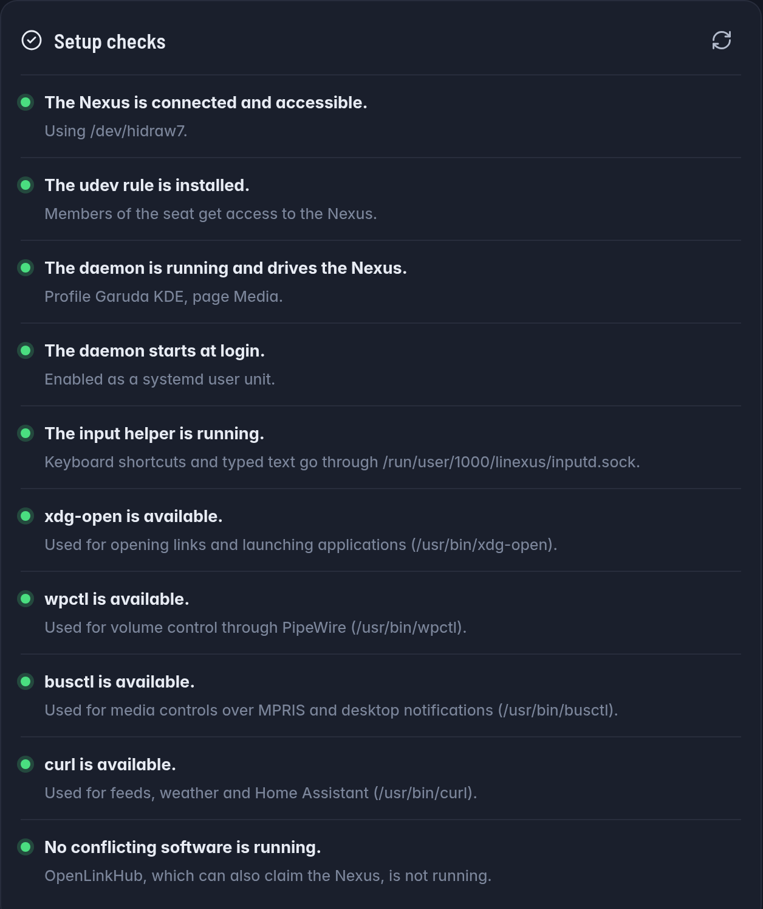

</td>
</tr>
</table>

### Backups you can share

Export all profiles, pages and images as one `.nexuspack` file and import it on another computer. Before an import replaces anything, Studio lists the buttons that run programs, type text or press keys, send web requests, open apps, files or links, call Home Assistant or control OBS, so you know what you bring in.

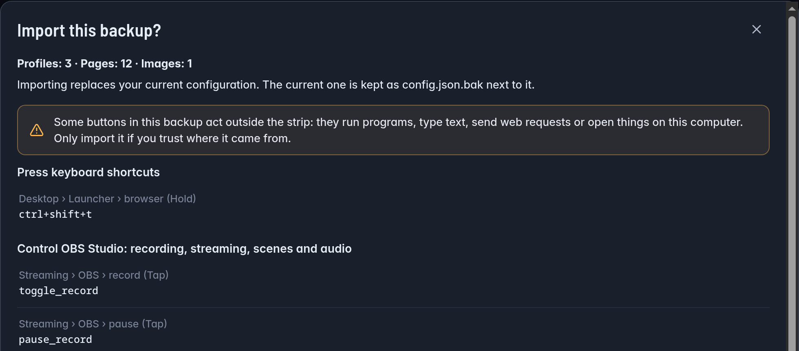

## Install

On x86_64 Linux with a systemd user session, run this as your desktop user:

```sh
curl -fsSL https://github.com/demoriaan/linexus/releases/latest/download/install.sh | bash
```

The script installs the `linexus` package with your package manager: pacman on Arch, apt on Debian and Ubuntu, dnf on Fedora, zypper on openSUSE, and their derivatives. Elsewhere it puts the prebuilt binaries in `~/.local/bin`. Then it sets up the daemon for your user and a default config. It asks for your sudo password for the parts that need root (the package, or the device rule) and checks every download against the checksum list of the release. Read [install.sh](install.sh) first if you like; `... | bash -s -- --help` lists its options.

**Manual download.** The [releases page](https://github.com/demoriaan/linexus/releases/latest) has a `.pkg.tar.zst` for Arch, a `.deb` for Debian and Ubuntu, an `.rpm` for Fedora and openSUSE, and a tarball with the binaries for everything else. Install the package with `sudo pacman -U`, `sudo apt install ./linexus_*.deb`, `sudo dnf install ./linexus-*.rpm` or `sudo zypper install --allow-unsigned-rpm ./linexus-*.rpm`.

**From source** (Rust 1.88 or newer, a C compiler, `pkg-config` and the libudev headers):

```sh
git clone https://github.com/demoriaan/linexus.git
cd linexus
packaging/scripts/install-dev.sh --start
```

On Arch, `packaging/arch/build-local-package.sh` builds the package from the checkout instead. [docs/install.md](docs/install.md) covers every option.

**With an AI agent.** Point your coding agent to [docs/ai-agents.md](docs/ai-agents.md). It lists the exact commands, how to verify the result, and which steps the agent has to hand to you because they need root.

It is developed and tested with the strip on Arch Linux with KDE Plasma 6 (Wayland). The installer and the packages are tested in containers on Ubuntu, Debian, Fedora, Rocky Linux, openSUSE and Arch Linux.

Then unplug and replug the Nexus, open **Linexus Studio** from your app launcher (or run `linexus-studio`) and check the Device section, or run `linexusctl doctor --fix` in a terminal.

Other software that drives Corsair devices, such as OpenLinkHub, can claim the Nexus too. Stop it, or exclude the Nexus in its settings.

## Documentation

- [Installation and troubleshooting](docs/install.md)
- [Installing with an AI agent](docs/ai-agents.md)
- [Using Linexus Studio](docs/studio.md)
- [Configuration reference](docs/configuration.md)
- [Input helper for shortcuts and typing](docs/input-helper.md)
- [Local API and `linexusctl`](docs/local-api.md)
- [Architecture](docs/architecture.md), for contributors
- [USB protocol notes](docs/protocol.md)

## Known limitations

- GPU load and VRAM readings support AMD and NVIDIA graphics; other GPUs (Intel) still show their hwmon temperatures and power where the driver exposes them.
- App-aware profiles are verified on KDE Plasma, and on GNOME in containers; the Hyprland, Sway and X11 watchers are less tested.
- One Nexus per computer.

## Contributing

Bug reports and pull requests are welcome. See [CONTRIBUTING.md](CONTRIBUTING.md) for the development setup and checks, and [SECURITY.md](SECURITY.md) for reporting vulnerabilities.

## License

MIT, see [LICENSE](LICENSE). Bundled fonts, icons and web libraries keep their own licenses, listed in [THIRD-PARTY-NOTICES.md](THIRD-PARTY-NOTICES.md).
