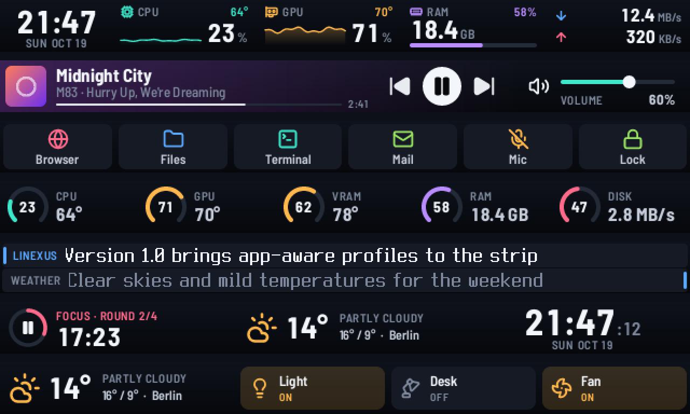
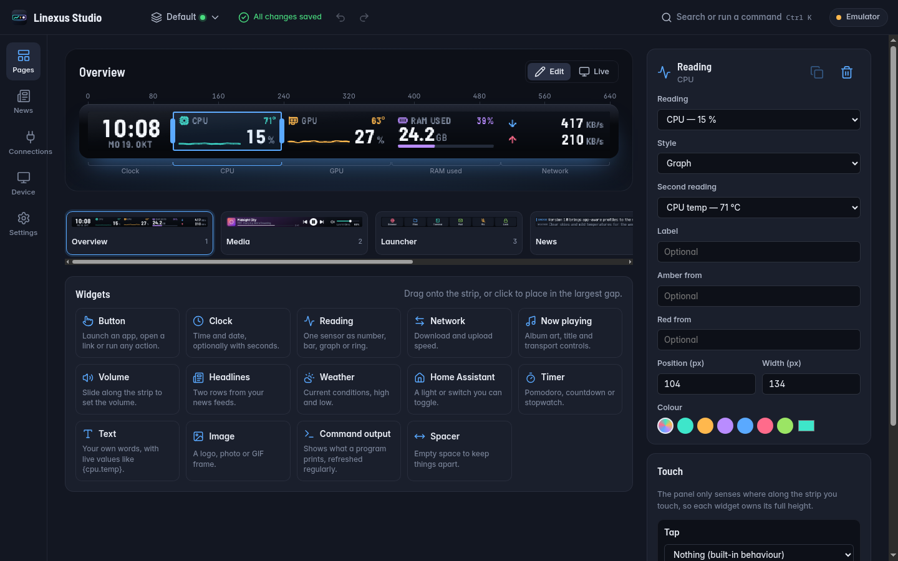

# Linexus

Run the Corsair iCUE Nexus touch strip on Linux, and design its pages in a visual editor.



The Nexus is a 640 × 48 pixel touch display that Corsair supports only through iCUE on Windows. Linexus drives it directly over USB HID: a small daemon renders the pages, reads touches and runs actions, and **Linexus Studio**, a local web app, lets you build those pages with the same renderer the strip uses.

> Unofficial project. Not affiliated with, endorsed by or sponsored by Corsair. Corsair, iCUE and Nexus are trademarks of their respective owners and are used only to name the supported hardware.

## What it does

**On the strip**

- 15 widget types: clock, sensor readings (number, bar, graph or ring), network speed, now playing with album art and transport controls, a volume slider, buttons with app icons and a running-app dot, scrolling news headlines, weather, Home Assistant switches, Pomodoro/countdown/stopwatch timers, text with live values, images, command output and spacers.
- Touch that feels native: tap, double tap, hold, repeat while held, drag the volume slider, and swipe between pages with the page following your finger.
- Actions: launch apps from their desktop entries, open links and folders, media keys over MPRIS, volume and microphone mute through PipeWire or PulseAudio, keyboard shortcuts and typed text (also on Wayland), switch pages and profiles, brightness, lock the screen, call Home Assistant services, control OBS Studio (record, stream, scenes, mute), send HTTP requests, run programs (opt-in), or chain several actions.
- Desktop notifications, volume changes and track changes appear as short overlays.
- OBS Studio buttons show what OBS is doing: recording and stream time, the scene on air, muted sources.
- Profiles switch on their own when a given app is focused (KDE Plasma, GNOME, Hyprland, Sway, X11), and hidden pages work as folders that close after a timeout.
- The strip dims or turns off when idle, turns off while the session is locked, and wakes on the first touch without triggering anything.

**Linexus Studio**



- Drag widgets from the library onto the strip, move and resize them on an 8 px grid, and set what each gesture does.
- Changes save automatically, and the strip jumps to the page you are editing so you can check it on the device. Undo and redo cover the whole session.
- A live mirror shows what the strip shows right now; clicking or dragging on it acts like a touch on the strip.
- Page templates, six colour themes with a custom accent, page backgrounds, a command palette (Ctrl+K), English and German, light and dark mode.
- Setup checks explain what is missing (device access, services, helper programs) and give the command that fixes it.
- Export and import complete setups as `.nexuspack` files.

**Linux sensors**

CPU, GPU (AMD through amdgpu, NVIDIA through nvidia-smi), memory, disks and network from `/proc` and `/sys`, every hwmon sensor (temperatures, fans, power, voltages), battery levels of wireless mice, keyboards, headsets and controllers through UPower, MPRIS media and PipeWire volume. While the strip shows live readings, the daemon and the helper programs it calls use a few percent of one CPU core.

## Install

On x86_64 Linux with a systemd user session, run this as your desktop user:

```sh
curl -fsSL https://github.com/demoriaan/linexus/releases/latest/download/install.sh | bash
```

The script installs the `linexus` package with your package manager: pacman on Arch, apt on Debian and Ubuntu, dnf on Fedora, zypper on openSUSE, and their derivatives. Elsewhere it puts the prebuilt binaries in `~/.local/bin`. Then it sets up the daemon for your user and a default config. It asks for your sudo password for the parts that need root (the package, or the device rule) and checks every download against the checksum list of the release. Read [install.sh](install.sh) first if you like; `... | bash -s -- --help` lists its options.

**Manual download.** The [releases page](https://github.com/demoriaan/linexus/releases/latest) has a `.pkg.tar.zst` for Arch, a `.deb` for Debian and Ubuntu, an `.rpm` for Fedora and openSUSE, and a tarball with the binaries for everything else. Install the package with `sudo pacman -U`, `sudo apt install ./linexus_*.deb`, `sudo dnf install ./linexus-*.rpm` or `sudo zypper install --allow-unsigned-rpm ./linexus-*.rpm`.

**From source** (Rust 1.88 or newer, a C compiler, `pkg-config` and the libudev headers):

```sh
git clone https://github.com/demoriaan/linexus.git
cd linexus
packaging/scripts/install-dev.sh --start
```

On Arch, `packaging/arch/build-local-package.sh` builds the package from the checkout instead. [docs/install.md](docs/install.md) covers every option.

**With an AI agent.** Point your coding agent to [docs/ai-agents.md](docs/ai-agents.md). It lists the exact commands, how to verify the result, and which steps the agent has to hand to you because they need root.

It is developed and tested with the strip on Arch Linux with KDE Plasma 6 (Wayland). The installer and the packages are tested in containers on Ubuntu, Debian, Fedora, Rocky Linux, openSUSE and Arch Linux.

Then unplug and replug the Nexus, open **Linexus Studio** from your app launcher (or run `linexus-studio`) and check the Device section. `linexusctl doctor` prints the same checks in a terminal; `linexusctl doctor --fix` applies the safe fixes.

Other software that drives Corsair devices, such as OpenLinkHub, can claim the Nexus too. Stop it, or exclude the Nexus in its settings.

## Documentation

- [Installation and troubleshooting](docs/install.md)
- [Installing with an AI agent](docs/ai-agents.md)
- [Using Linexus Studio](docs/studio.md)
- [Configuration reference](docs/configuration.md)
- [Input helper for shortcuts and typing](docs/input-helper.md)
- [Local API and `linexusctl`](docs/local-api.md)
- [Architecture](docs/architecture.md), for contributors
- [USB protocol notes](docs/protocol.md)

## Known limitations

- GPU load and VRAM readings support AMD and NVIDIA graphics; other GPUs (Intel) still show their hwmon temperatures and power where the driver exposes them.
- App-aware profiles are verified on KDE Plasma; the Hyprland, Sway and X11 watchers are less tested.
- One Nexus per computer.

## Contributing

Bug reports and pull requests are welcome. See [CONTRIBUTING.md](CONTRIBUTING.md) for the development setup and checks, and [SECURITY.md](SECURITY.md) for reporting vulnerabilities.

## License

MIT, see [LICENSE](LICENSE). Bundled fonts, icons and web libraries keep their own licenses, listed in [THIRD-PARTY-NOTICES.md](THIRD-PARTY-NOTICES.md).
